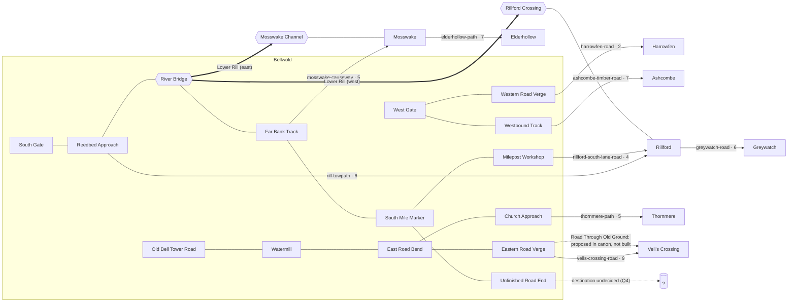

# Bellwold Region Expansion

**Status:** In delivery. Phases 0–2 are on `main`. Phase 3 is in progress on `content/bellwold-phase-3`; Mosswake and Thornmere are implemented. Phases 4–5 remain proposals. Q1 (river identity), Q5 (travel scale) and Q7 (the Rillford crossing) were decided on 2026-10-31.
**Pack:** `orraveth.bellwold` ([layout](../../../packages/world-orraveth/src/map/), [content](../../../packages/world-orraveth/src/index.ts)), currently `packVersion` 1.20.0 with 119 locations. The single Phase 3 PR will bump to 1.21.0 in its final town commit. Sections 1 and 2 describe the Codex and world data as they stood before Phase 1.
**Scope:** New roads, new towns, extending the existing river, and connecting Bellwold to the communities of the Bellwold Marches.

## How to read this document

- **Canon** means a fact stated in the Orraveth Codex (`apps/web/src/codex/content/`). Each canon claim cites its Codex file.
- **Proposal** means something this spec invents to make the region playable: a room, a road alignment, a step count, a placeholder name. Proposals are not canon. They need Codex review before anyone writes them back into the Codex.
- **World data** means the composed pack: layout in `packages/world-orraveth/src/map/` plus content in `packages/world-orraveth/src/index.ts`. Historical findings below describe the original TypeScript pack.

Most of the Marches communities are **Provisional Canon**: their populations, travel times and politics are recorded but can still change ([regions/bellwold-marches.md][marches]). This spec follows those records. It doesn't harden them.

---

## 1. What the Codex says

### 1.1 Bellwold

- Bellwold is a growing trading settlement near the frontier of the Crown of Heskar. Farming, milling, smithing, trade, lodging and small crafts support it ([regions/bellwold.md][bellwold]).
- It is an important local market, but smaller than Rillford and Vell's Crossing. Its exact legal status is not established ([regions/bellwold.md][bellwold], [regions/bellwold-marches.md][marches]).
- Bellwold's roads, as the Codex describes them:
  - An unfinished road leaves south from the Common House, crosses the **Lower Rill** by a low stone bridge, and ends at a shallow cut. No settlement lies beyond it, and its destination is unrecorded ([regions/bellwold.md][bellwold], [culture/trade-transport.md][trade]). Until 2026-10-31 both entries called this river "unnamed" (see Q1).
  - The west road runs from the Kindly Roof to an unmarked verge ([regions/bellwold.md][bellwold], [culture/trade-transport.md][trade]).
  - The eastbound mill road branches from Old Bell Tower Road, passes the abandoned watermill and ends beyond a low rise ([regions/bellwold.md][bellwold]).
  - None of these roads has an established destination or travel time ([culture/trade-transport.md][trade]).
- The eastern forest lies beyond Bellwold. The old bell is said to have come from it. The forest must not be treated as empty ([places/eastern-forest.md][eastern-forest]).
- Animals recorded along Bellwold's roads are stray hounds, reedback boars (wet ground, reedbeds, drainage channels), ditch foxes (field margins, culverts) and bank badgers (dry rises, road embankments). The Codex records them as ordinary wildlife, not sprites ([regions/bellwold-roadside-wildlife.md][wildlife]).

### 1.2 The Bellwold Marches

The Codex calls the region around Bellwold the Bellwold Marches. Some accounts call it the Lower Rill. Neither name fixes a boundary ([regions/bellwold-marches.md][marches]).

The Codex's own directory gives this layout and stresses that it is approximate and **not a surveyed map**. Trade relationships **do not imply a direct road** ([regions/bellwold-marches.md][marches], [culture/trade-transport.md][trade]).

| Community | From Bellwold | Travel time | Population | Political status | Trade | Source |
|---|---|---|---|---|---|---|
| Harrowfen | West | ½ day | ~340 | Crown of Heskar; noble-held farmland, elected reeve | Grain, roots, flax | [harrowfen.md][harrowfen] |
| Ashcombe | Northwest | 1 day | ~210 | Crown of Heskar | Timber, charcoal, wooden goods | [ashcombe.md][ashcombe] |
| Rillford | Southwest, along the Lower Rill | 1 day | ~620 | Crown of Heskar | Transport, traded goods | [rillford.md][rillford] |
| Greywatch | Farther southwest | 2 days | ~480 incl. garrison | Crown; military administration | Military contracts, security | [greywatch.md][greywatch] |
| Thornmere | Northeast | 1 day | ~190 | Independent council | Herbs, knowledge, cooperative sprite services | [thornmere.md][thornmere] |
| Vell's Crossing | East | 1½ days | ~850 | Disputed | Imported goods, alchemical products | [vells-crossing.md][vells] |
| Mosswake | Southeast | 1 day | ~270 | Independent river community | Fish, reeds, medicinal plants | [mosswake.md][mosswake] |
| Elderhollow | Farther southeast | 2 days | ~130 | Autonomous woodland community | Crafts, historical knowledge | [elderhollow.md][elderhollow] |

### 1.3 The Lower Rill

- "Lower Rill" is the provisional name for the river passing near Bellwold. Its full course and its relationship to the Rillward Freeholds are unresolved ([regions/lower-rill.md][lower-rill]).
- The river matters to Rillford's crossing and trade. Mosswake's wetlands depend on connected waterways ([regions/lower-rill.md][lower-rill]).
- Rillford grew up around river passage, warehouses and a weekly livestock market. Merchant guilds, customs officials, inns and warehouses cluster at the crossing. A ferry guild wants exclusive rights, and independent boatmen oppose it ([regions/rillford.md][rillford]).
- Some Rillford crews associate a river sprite, Old Silverfin, with the crossing and say it overturns boats carrying certain cargoes. Nothing about this is verified ([sprites/old-silverfin.md][silverfin]).
- No navigation rights or schedules are established. Passage is governed by conditions and local agreements ([regions/lower-rill.md][lower-rill], [regions/rillward-freeholds.md][rillward]).

### 1.4 Each community in brief

- **Harrowfen.** Low fields and drainage cuts; a shared threshing green and a village weigh-house. Reeve Maela Thorn speaks for farmers. Much of the land belongs to Heskar noble families. Harvests are falling for reasons nobody has established (the Vanishing Grain). A commercial interest offers cheap grain in exchange for Veyl extraction rights. Harrowfen relies on smiths and repairers from elsewhere for its tools ([harrowfen.md][harrowfen], [maela-thorn.md][maela], [vanishing-grain.md][grain]).
- **Ashcombe.** Timber yards and charcoal kilns. Access to forest stands is disputed under new Heskar concessions. Carpenter Oren Kest refuses timber from certain stands. An old oak that seemed to weep clear sap was felled, and workers have since reported voices in the lumber; neither account is verified ([ashcombe.md][ashcombe], [oren-kest.md][oren]).
- **Rillford.** The crossing, the guild dispute and Old Silverfin, described in §1.3. Guildmistress Selda Rook supports regulated river commerce and wants cargoes documented before anyone draws conclusions ([rillford.md][rillford], [selda-rook.md][selda]).
- **Greywatch.** A fortified signal tower came first and the outpost grew around it. It investigates banditry, guards routes and employs civilian carriers, cooks, smiths and suppliers. Captain Edric Vaul commands. Heskar has ordered surveys of eastern territories ([greywatch.md][greywatch], [edric-vaul.md][edric]).
- **Thornmere.** Woodland beside a shallow lake. Sprites share some buildings, bridges and communal spaces. Elder mediator Nessa Valeen settles human–sprite agreements. Commercial Veyl harvesting is prohibited, and a healer's purchase of essence-based medicine for a critically ill child is now in dispute ([thornmere.md][thornmere], [nessa-valeen.md][nessa]).
- **Vell's Crossing.** Grew around a narrow passage through rocky terrain and its trading yards. Guild representatives, landholders and neighbourhood delegates govern together. Jarek Vell is influential but doesn't rule. The Crown's claim is disputed. Some potions sold here are linked to destructive extraction (the Hollow Trade), and agents of Severin Vale operate in the town ([vells-crossing.md][vells], [jarek-vell.md][jarek], [hollow-trade.md][hollow]).
- **Mosswake.** Raised platforms on wet ground; fishing, boatbuilding, herbalism and marsh navigation. Some wetland areas are recognised sprite territories, with no complete map of them. Fish numbers are falling. A consortium wants to dredge Veyl deposits. Young boatbuilder Tavin Reed lives here ([mosswake.md][mosswake], [tavin-reed.md][tavin]).
- **Elderhollow.** Homes follow immense trees and are linked by raised walkways and forest paths. Assemblies govern. Archivist Caeren Moss keeps oral histories, including accounts of forest sprites falling silent. Professor Elira Venn was studying these histories before she disappeared; no connection to the Silent Bell is established ([elderhollow.md][elderhollow], [caeren-moss.md][caeren], [silent-bell.md][bell]).

### 1.5 Pressures that cross the region

- **The Road Through Old Ground.** Heskar has *proposed* a major road linking Greywatch, Bellwold and Vell's Crossing. It would cross land used or governed by independent communities and forest sprites. The route, schedule and outcome are unsettled ([mysteries/road-through-old-ground.md][old-ground]).
- **The Vanishing Grain** in Harrowfen ([mysteries/vanishing-grain.md][grain]).
- **The Hollow Trade** in Vell's Crossing, with related Veyl disputes in Mosswake and Thornmere ([mysteries/hollow-trade.md][hollow], [alchemy/veyl.md][veyl]).
- **Concealed, GM-only canon.** The watermill hides an extraction apparatus run by an agent of Severin Vale. Residents don't know this, and player-facing text must not reveal it ([mysteries/mill-that-never-sleeps.md][mill], [world-bible.md](world-bible.md)).

### 1.6 Principles the Codex imposes on any expansion

1. **A road is not a claim.** A survey line can be read as ownership, so roads through independent or contested land must not be presented as Heskar's ([greywatch.md][greywatch], [road-through-old-ground.md][old-ground], [uncrowned-lands.md][uncrowned]).
2. **A blank map is not empty land.** Woods and wetlands beyond roads are lived in and used ([uncrowned-lands.md][uncrowned], [eastern-forest.md][eastern-forest], [frontier-settlements.md][frontier]).
3. **No community speaks with one voice.** Every town page records internal disagreement. NPCs should hold positions, not represent the whole town ([cultures-and-customs.md][customs]).
4. **Keep reports separate from facts.** Mysteries stay unresolved in player-facing text ([world-bible.md](world-bible.md)).
5. **Distances, tolls and access are local facts.** Don't invent them from a generic continental map ([culture/trade-transport.md][trade]).
6. **Gold has no fixed value.** Any price is a gameplay placeholder, not canon ([culture/currency-commerce.md][currency]).

---

## 2. Bellwold in the world data today

### 2.1 Data model

All world content is one `WorldPackDraft`, validated by `WorldPackDraftSchema` and `validateDraftWorldGraph` in `engine-contracts/src/world.ts`.

| Concept | Shape | Notes for this spec |
|---|---|---|
| Location | `LocationDefinition`: `id`, `name`, `description`, `mapPosition {x, y, z?, terrain?, mapColor?, visibleWhenUnvisited?}`, `exits`, plus optional `npcs`, `readables`, `takeables`, `interactables`, `itemUses`, `containers`, `inn`, `states` / `defaultStateId`, `mapAreaId`, `regionId`, `requiredVisitedLocationId` | One room = one map tile. Orraveth doesn't use `regionId` yet. |
| Exit | `ExitDefinition`: `id`, `fromLocationId`, `toLocationId`, `label`, `direction`, `roadId?`, `fromStateId?`, `toStateId?`, `requiredInteractionId?`, `mapLineGapAtLocationId?` | The Orraveth integration test requires `north`/`east`/`south`/`west`/`up`/`down`, a matching reverse exit, and a destination exactly one tile away in the exit's direction. **Diagonal travel has to be laid out as staircase routes.** |
| Road | `RoadDefinition`: `id`, `name`, ordered `locationIds` (3–100, endpoints included), `encounterChancePercent`, `encounters` (1–24) | Each exit tagged with a `roadId` must join two *adjacent* entries on that road. Moving along a road uses `character.road.step` and may roll an encounter ([ADR 0015](../../adr/0015-character-scoped-road-travel-and-encounters.md)). One location can sit on several roads; `bellwold-east-road-bend` already does. |
| Location state | `states` + `defaultStateId`; exits gated by `fromStateId` / `toStateId` | `bellwold-river-bridge` has `on` and `under` states: crossing the bridge versus going down onto the river. |
| Map | `mapAreaId` (omitted = overworld) and `z` | The crypt and upper floors use their own map area or Z level ([ADR 0008](../../adr/0008-current-area-and-level-maps.md)). `terrain` is a free presentation slug; `river` and `building` have fixed colours ([ADR 0025](../../adr/0025-map-terrain-and-crossing-presentation.md)). |
| Location groups | `locationGroups[]`: `id`, `name`, `type`, `description?`, `memberships[{locationId, isPrimary}]`, `metadata?` | **Orraveth has none yet.** A primary group qualifies room names, for example "Rillford: North Quay". Groups are seeded into Postgres once per `packId` + `packVersion`, so every change needs a version bump ([docs/location-groups.md](../../location-groups.md), [ADR 0021](../../adr/0021-versioned-location-group-catalog.md)). |
| Destination preview | `LocationTravelPreview` (`title`, `shortName`, `qualifiedName`, `description`, `roomDetails?`, `npcs?`) | Built on the server from the destination's normal, viewer-safe content. Anything in a description shows up **before arrival**, which is one more reason to keep GM-only canon out. |
| Activities | `fishingSpots`, `woodcuttingTrees`, `dailyBoards`, `craftingWorkbenchLocationIds`, NPC `shop`, location `inn`, NPC `movement` (`wander` / ordered route) | All are content-only. None needs engine work. |

### 2.2 Current geography

Coordinates are `(x, y)`; north is `+y`. The overworld runs from x −4 to 4 and y −10 to 4.

```
y= 4                          church(3,4)
y= 3                          church-approach
y= 2         tower(0,2)       north-church-track
y= 1         tower-road ─ mill ─ east-mill-track ─ east-road-bend ─ east-verge(4,1)
y= 0  west-verge(-4) ─ westbound ─ west-gate ─ inn ─ SQUARE ─ shop
y=-1                 green-mortar ─ south-common ─ forge
y=-2 … -5            [southern lanes, homes, jail, library, museum]
y=-4                          south-gate
y=-5                          southbound-track
y=-6                          reedbed-approach
y=-7  river reaches x=-3…-1 ═ BRIDGE(0,-7) ═ river reaches x=1…3
y=-8                          far-bank-track
y=-9  milepost-workshop(-3) ─ hazel-cut ─ mile-west-track ─ south-mile-marker
y=-10                         unfinished-road-end
```

### 2.3 Current roads

| Road id | Route | Encounters (10%) |
|---|---|---|
| `bellwold-west-road` | west-gate → westbound-track → west-road-end ("Western Road Verge") | Stray hound, bandit |
| `bellwold-south-road` | south-gate → southbound → reedbed → river-bridge → far-bank → south-mile-marker → unfinished-road-end | Stray hound, roadside deer (deer hide), bandit |
| `bellwold-mile-west-road` | south-mile-marker → mile-west-track → hazel-cut → milepost-workshop | Stray hound, bandit |
| `bellwold-east-mill-road` | abandoned-watermill → east-mill-track → east-road-bend → east-road-verge | Stray hound, bandit |
| `bellwold-north-church-road` | east-road-bend → north-church-track → church-approach | Stray hound, bandit |

### 2.4 The river today

Seven `river` tiles at `y = −7`, from x −3 to 3: `bellwold-river-far-west-reach`, `-willow-reach`, `-west-reach`, `bellwold-river-bridge`, `-east-reach`, `-alder-reach`, `-far-east-reach`. You reach them only from the bridge's `under` state. The bridge carries a fishing spot (smallmouth bass, common carp, rainbow trout → `river-fish`). The Codex now identifies this river as the Lower Rill (Q1, decided). Phase 2 renamed the display names to Lower Rill names; the IDs are unchanged.

### 2.5 Content not yet in the Codex

The world data includes places the Codex doesn't document: the abandoned church and undercrypt, North Church Road, the library, the local museum, the jail, Hearth Alley, Lantern Court, Nettlemere House, the Milepost Workshop and others. This spec uses some of them as junctions only and doesn't extend their lore.

The Orraveth world docs are also out of date: [world-bible.md](world-bible.md) says 15 rooms, and [capability-inventory.md](capability-inventory.md) says the pack has no encounters. Both should be updated in a separate change.

---

## 3. Design decisions

### 3.1 Travel scale (decided, Q5)

**One travel day is about 8 road steps** (decided 2026-10-31), counted from the Bellwold room where a route leaves town to the destination's arrival room. This keeps the Codex's *ratios* (½ : 1 : 1½ : 2 days) while keeping room counts manageable:

| Codex time | Target steps |
|---|---|
| ½ day | 4 |
| 1 day | 8 |
| 1½ days | 12 |
| 2 days | ~16 (via an intermediate settlement where the Codex gives a "farther" direction) |

The map is a schematic. Towns will look closer to Bellwold than a real day's walk, and that's acceptable. The scale is a gameplay convention, not canon; the Codex still gives only days. Individual routes may run a step or two over or under to fit the grid.

### 3.2 Extend roads by adding new ones

Wherever possible, a new road **starts at an existing road's endpoint** (for example, a new Harrowfen road whose first entry is `bellwold-west-road-end`) rather than extending the old road's `locationIds`. This:

- leaves existing roads untouched, so the `roadId` and `segmentIndex` recorded in past `character.moved` events stay meaningful;
- follows the shared-junction pattern `bellwold-east-road-bend` already uses;
- lets each road carry its own encounter pool.

The verge rooms keep their IDs. Only their names and descriptions change ("the track ends" becomes "the track continues toward Harrowfen"). The place is the same, so this doesn't break the rule against repurposing an ID ([world-bible.md](world-bible.md)).

### 3.3 Roads in independent land are paths, not Crown roads

The routes to Thornmere, Mosswake and Elderhollow are footpaths, causeways and walkways kept by the people who use them. Their names and descriptions shouldn't suggest Heskar built or claims them. Encounter rates are lower, and there are no bandits on them; the Codex gives no basis for banditry there.

### 3.4 What stays out

- **The unfinished south road stays unfinished.** The Codex says its end "gives no basis for assuming a destination" ([trade-transport.md][trade]). See Q4.
- **The Road Through Old Ground is not built.** It is only proposed in canon. Survey stakes and notices can appear on the existing east track; the road itself can't ([road-through-old-ground.md][old-ground]).
- **No concealed canon in player-facing text.** The mill apparatus, the identity of Severin Vale's agents and which batches are tainted stay out of descriptions, readables, dialogue and previews.
- **No new named characters without review.** New service NPCs are roles ("a customs clerk", "a garrison cook"). Named NPCs come only from the Codex.

---

## 4. Proposed additions

Every room, road, name and step count below is a **proposal** unless it's cited. Coordinates were checked against the live pack: none of the 92 proposed tiles collides with an existing overworld tile or with another proposed tile.

### 4.1 Roads

| Proposed road id | From (existing) → to | Steps | Lore basis | Encounter pool (proposal, from [wildlife][wildlife]) | Chance |
|---|---|---|---|---|---|
| `harrowfen-road` | `bellwold-west-road-end` (−4,0) → `harrowfen-east-field-gate` (−6,0) | 4 from West Gate | Harrowfen lies ½ day west; west road already points there | Ditch fox (field margins), reedback boar (drainage cuts), stray hound | 10% |
| `ashcombe-timber-road` | `bellwold-westbound-track` (−3,0) → `ashcombe-timber-yard` (−7,3) | 8 from West Gate | Ashcombe lies 1 day northwest; timber moves by heavy road loads ([ashcombe.md][ashcombe]) | Bank badger (cut banks), stray hound, roadside deer | 10% |
| `rill-towpath` | `bellwold-reedbed-approach` (0,−6) → `rillford-north-quay` (−6,−6) | 8 from South Gate | Rillford lies 1 day southwest *along the Lower Rill corridor* ([rillford.md][rillford]) | Reedback boar (reedbeds), ditch fox (culverts), stray hound | 10% |
| `rillford-south-lane-road` | `bellwold-milepost-workshop` (−3,−9) → `rillford-south-landing` (−6,−8) | 4 | Gives Rillford's south bank a land link and closes a loop round the river | Stray hound, ditch fox | 10% |
| `greywatch-road` | `rillford-south-lane` (−6,−9) → `greywatch-signal-gate` (−10,−11) | 6 (≈17 total from Bellwold) | Greywatch lies *farther* southwest, 2 days; guards routes and investigates banditry ([greywatch.md][greywatch]) | Bandit, stray hound, ditch fox | 12% |
| `mosswake-causeway` | `bellwold-far-bank-track` (0,−8) → `mosswake-landing` (5,−8) | 9 from South Gate | Mosswake lies 1 day southeast; marsh travel ([mosswake.md][mosswake]) | Reedback boar, stray hound | 6% |
| `elderhollow-path` | `mosswake-south-platforms` (6,−9) → `elderhollow-first-walkway` (11,−11) | 7 (≈18 total) | Elderhollow lies *farther* southeast, 2 days; forest paths ([elderhollow.md][elderhollow]) | Roadside deer, bank badger | 5% |
| `thornmere-path` | `bellwold-church-approach` (3,3) → `thornmere-lakeshore` (6,5) | 5 (≈9 from the watermill) | Thornmere lies 1 day northeast ([thornmere.md][thornmere]) | Bank badger, roadside deer | 5% |
| `vells-crossing-road` | `bellwold-east-road-verge` (4,1) → `vells-trading-yards` (13,1) | 9 (12 from the watermill) | Vell's Crossing lies 1½ days east, through a narrow rocky passage ([vells-crossing.md][vells]); the route runs through the eastern forest ([eastern-forest.md][eastern-forest]) | Stray hound, bank badger, bandit | 10% |

Encounter stats are gameplay tuning. New animals (ditch fox, reedback boar, bank badger) need combat profiles. Keep their names and descriptions faithful to the wildlife entry, and never hint that they're sprites.

### 4.2 The Lower Rill

Extend the river along the same row (`y = −7`), using the bridge's pattern: `river` terrain tiles, `visibleWhenUnvisited: true`, and plain exits between reaches.

| Proposed location | (x, y) | Notes |
|---|---|---|
| `lower-rill-reed-reach` | (−4,−7) | Continues west from `bellwold-river-far-west-reach` |
| `lower-rill-towpath-reach` | (−5,−7) | Towpath visible on the north bank |
| `rillford-crossing` | (−6,−7) | "Ferry Stage". **States** `stage` (the timber stage, reached from the north quay) and `water` (out on the river, linking the reaches east and west). This mirrors the bridge's `on`/`under` states. *Revised in Phase 2 (Q7):* the stage doesn't link to the south landing, because the Codex records a ferry crossing with a contested ferry trade and no settled right of passage. |
| `lower-rill-west-of-rillford` | (−7,−7) | Terminal reach for now (see Q2) |
| `lower-rill-sedge-reach` | (4,−7) | Continues east from `bellwold-river-far-east-reach` |
| `mosswake-channel` | (5,−7) | Where the river meets Mosswake's channels; exit south to `mosswake-landing` |
| `mosswake-open-water` | (6,−7) | Open water by the platforms. Readable: a public dredging-survey notice. |

**River identity (decided, Q1).** The bridged river is the Lower Rill. New river rooms use Lower Rill names, such as "Lower Rill: Reed Reach" and "Lower Rill: Sedge Reach". The existing `bellwold-river-*` rooms keep their IDs. Phase 2 renamed their display names: the bridge is "Lower Rill Bridge" and the reaches drop the "River" prefix, taking "Lower Rill" from their primary `lower-rill` group. The names say nothing about which way the river flows; that is still open (Q2).

**Fishing (proposal).** Add `fishingSpots` at `lower-rill-towpath-reach` and `mosswake-open-water`. *Revised in Phase 2:* players can't walk onto river tiles (the reaches open only from a crossing's water state), so the towpath spot sits on the bank at `rill-towpath-mooring-posts`. The Mosswake spot should be noticeably sparser, reflecting the recorded fish decline, without suggesting a cause ([mosswake.md][mosswake]). Don't put a fishing spot on `rillford-crossing`; crews there treat the river's behaviour as unresolved ([old-silverfin.md][silverfin]).

**Boats and ferries are deferred.** River travel stays as walking or wading between reaches, as it is today. A paid ferry, or rules for the guild dispute, would need a new paid-passage capability (compare [ADR 0007](../../adr/0007-character-scoped-paid-inn-rest.md)). The Codex also sets no fares or rights of passage (Q7).

### 4.3 Towns

Each town is a small, connected cluster of 5–9 rooms. NPCs listed by name come from the Codex; everyone else is an unnamed role.

#### Harrowfen: "The Village of a Hundred Fields" (Phase 1)

| Location | (x, y) | Terrain | Content |
|---|---|---|---|
| `harrowfen-road-ditch-verge` | (−5,0) | land | Road segment. Drainage ditch and field edge. |
| `harrowfen-east-field-gate` | (−6,0) | pasture | Road endpoint and arrival room |
| `harrowfen-threshing-green` | (−7,0) | pasture | Shared threshing green; the centre of the village ([harrowfen.md][harrowfen]) |
| `harrowfen-weigh-house` | (−7,1) | building | **Reeve Maela Thorn**, who handles village business. Readable: a season's yield tallies with the decline recorded and no cause given ([vanishing-grain.md][grain]). |
| `harrowfen-drainage-cut` | (−7,−1) | land | Drainage channels; disputed water management |
| `harrowfen-tenant-row` | (−8,0) | dirt | Labourers' and tenants' cottages; the land belongs to noble families |
| `harrowfen-west-fields` | (−9,0) | dirt | Open fields running on. A boundary stone marks an estate (proposal). |

- **Services:** none that the Codex establishes. Harrowfen gets its tools mended elsewhere, so it has **no forge**. A `dailyBoard` for flax or field help could work, with gold amounts as placeholders.
- **Maela Thorn's topics:** yields, landholders, the grain-for-extraction offer, presented as a contested proposal with no named sponsor ([vanishing-grain.md][grain]).

#### Ashcombe: "Where the Forest Becomes Timber" (Phase 3)

| Location | (x, y) | Terrain | Content |
|---|---|---|---|
| `timber-road-cutbank` … `timber-road-skid-trail` | (−3,1)…(−6,3) | land / dirt | 6 road segments: cut bank, hauling track, rise, kiln smoke on the wind, stand edge, skid trail |
| `ashcombe-timber-yard` | (−7,3) | dirt | Road endpoint. Seasoning stacks. |
| `ashcombe-charcoal-kilns` | (−7,4) | land | Kilns |
| `ashcombe-kest-workshop` | (−8,3) | building | **Oren Kest**, carpenter. Topics: why some stands are refused, and the concessions. |
| `ashcombe-cart-yard` | (−8,4) | dirt | Cartwrights at work; an unnamed role NPC |
| `ashcombe-felled-oak-clearing` | (−7,5) | land | The stump of the oak said to have wept clear sap. Description only; no woodcutting here. |

- **Woodcutting (proposal):** `woodcuttingTrees` only along the timber road's stand-edge segment, described as "a stand Ashcombe's yards cut by long agreement". Avoid presenting any concession stand as settled ([ashcombe.md][ashcombe], [oren-kest.md][oren]).
- **Supply link:** charcoal and logs as `dailyBoard` items for Blackwater Forge would fit the Codex's trade links.

#### Rillford: "The River's Gate" (Phase 2)

| Location | (x, y) | Terrain | Content |
|---|---|---|---|
| `rill-towpath-willow-bank` … `rill-towpath-quay-lane` | (−1,−6)…(−5,−6) | land / dirt | 5 towpath segments: willow bank, mooring posts, sedge flats, culvert, quay lane |
| `rillford-north-quay` | (−6,−6) | cobblestone | Towpath endpoint. Loading, repairs, watching the current. |
| `rillford-customs-house` | (−7,−6) | building | Customs officials (role NPC). Readable: a public cargo-and-passage notice. |
| `rillford-guild-hall` | (−6,−5) | building | **Guildmistress Selda Rook.** Topics: regulated commerce, the ferry dispute, why cargoes should be documented. |
| `rillford-inn` | (−7,−5) | building | "Quayside Inn", a descriptive placeholder name awaiting Codex review (Q8). Free safe resting, like the Kindly Roof. |
| `rillford-warehouse-row` | (−8,−6) | dirt | Warehouses. An independent boatman (role NPC) gives the opposing view. |
| `rillford-livestock-market` | (−8,−5) | pasture | The weekly livestock market |
| `rillford-crossing` | (−6,−7) | river | Ferry Stage; see §4.2. Readable: a crew slate recording overturned boats with no common cargo. |
| `rillford-south-landing` | (−6,−8) | land | South bank. Faces the stage; no boat is carrying. |
| `rillford-south-lane` | (−6,−9) | dirt | Junction for the Mile road and the Greywatch road |
| `mile-road-sedge-track`, `mile-road-landing-lane` | (−4,−9), (−5,−9) | dirt | Segments of `rillford-south-lane-road` |

- **Old Silverfin** shows up only as crew talk: competing accounts, with nobody claiming knowledge of its motives ([old-silverfin.md][silverfin]).
- **NPC movement:** a customs officer could patrol quay → customs house → crossing on an ordered route.

#### Mosswake: "The People of the Reeds" (Phase 3)

| Location | (x, y) | Terrain | Content |
|---|---|---|---|
| `mosswake-causeway-reedbank` … `mosswake-causeway-sedge` | (1,−8)…(4,−8) | land / `marsh`* | 4 causeway segments |
| `mosswake-landing` | (5,−8) | marsh* | Causeway endpoint |
| `mosswake-boat-sheds` | (5,−9) | building | **Tavin Reed**, boatbuilder. Topics: hull work in shallow channels, the dredging proposal (undecided). |
| `mosswake-herb-platform` | (6,−8) | building | Herbalists (role NPC); medicinal plants. A possible merchant with placeholder prices. |
| `mosswake-territory-edge` | (7,−8) | marsh* | Description: families recognise the water beyond as a sprite territory. **No exits lead into it** ([mosswake.md][mosswake]). |
| `mosswake-south-platforms` | (6,−9) | marsh* | Start of the Elderhollow path |

\* `marsh` is a new presentation-only terrain slug with a chosen land `mapColor`; it has no rule effect ([ADR 0025](../../adr/0025-map-terrain-and-crossing-presentation.md)).

*Revised in Phase 3:* Mosswake's marsh tiles use the land colour `#74865a` with
no movement or gathering rule. Its landing has a sparse fishing spot using the
existing five-second tick interval: a ten-second rod cast gets two bite
opportunities instead of ten. Species remain the existing Lower Rill fish;
neither catches nor dialogue establish a cause for the decline. There are no
new prices or passage mechanics. Families' recognition of territory is explained
by a herbalist, rather than asserted as invisible knowledge in room prose.

#### Thornmere: "The Village That Listens" (Phase 3)

| Location | (x, y) | Terrain | Content |
|---|---|---|---|
| `thornmere-path-church-field` … `thornmere-path-lake-glimpse` | (4,3)…(5,5) | land | 4 path segments: church field, birch run, brook, lake glimpse |
| `thornmere-lakeshore` | (6,5) | land | Path endpoint |
| `thornmere-council-house` | (6,6) | building | **Nessa Valeen.** Topics: what an agreement needs, why nobody promises on behalf of an unheard sprite. |
| `thornmere-shared-bridge` | (7,5) | land | A bridge shared with a sprite, per local accounts. Description only; no interaction that asks a sprite to respond ([thornmere.md][thornmere], [kindly-roof-hearth.md][hearth]). |
| `thornmere-healer-house` | (7,6) | building | The healer is **unnamed** in the Codex. Leave the medical-exception story to dialogue from others until reviewed (Q9). |
| `thornmere-lake` | (8,5) | lake* | A scenery tile, reached from the bridge |

*Revised in Phase 3:* the lake reuses `river` terrain and its existing water
presentation, with no new rule or `lake` slug. The shared bridge has description
and ordinary exits only: no NPC, interactable or item-use asks a sprite to
respond. The healer remains offstage (Q9); Nessa can discuss the unresolved
medical exception without announcing a council decision.

#### Vell's Crossing: "The Town Without a King" (Phase 4)

| Location | (x, y) | Terrain | Content |
|---|---|---|---|
| `vells-road-forest-edge` … `vells-road-scree` | (5,1)…(11,1) | land / gravel | 7 segments through the eastern forest. `vells-road-survey-stakes` (8,1) holds a readable: a Heskar survey notice for the proposed road, worded as a proposal ([road-through-old-ground.md][old-ground]). |
| `vells-narrows` | (12,1) | gravel | The narrow rocky passage the town grew around |
| `vells-trading-yards` | (13,1) | dirt | Road endpoint; imported goods |
| `vells-civic-hall` | (13,2) | building | Guild, landholder and neighbourhood delegates (role NPCs with differing views) |
| `vells-counting-house` | (14,1) | building | **Jarek Vell.** Topics: trade and the town's founding family. His knowledge of the Hollow Trade stays unresolved ([jarek-vell.md][jarek]). |
| `vells-apothecary-row` | (13,0) | building | Potion sellers. Dialogue reflects the provenance debate ([hollow-trade.md][hollow], [essence-provenance.md][provenance]). **No line or item identifies a tainted batch or an agent.** |
| `vells-inn` | (14,0) | building | `inn` with a placeholder price |

#### Greywatch: "The King's Last Lantern" (Phase 4)

| Location | (x, y) | Terrain | Content |
|---|---|---|---|
| `greywatch-road-south-lane` … `greywatch-road-approach` | (−6,−10)…(−9,−11) | dirt / land | 5 segments; `greywatch-road-watch-cairn` (−7,−11) marks the patrol line |
| `greywatch-signal-gate` | (−10,−11) | land | Road endpoint |
| `greywatch-parade-yard` | (−11,−11) | dirt | A sentry on an ordered patrol route |
| `greywatch-signal-tower` | (−11,−10) | building | The founding signal tower; `up` to a lamp room at Z+1 |
| `greywatch-command-house` | (−12,−11) | building | **Captain Edric Vaul.** Readable: the public text of the eastern survey order. |
| `greywatch-supply-yard` | (−11,−12) | building | Civilian carriers, cooks and smiths employed by the garrison (role NPCs) |

#### Elderhollow: "Beneath the First Trees" (Phase 4)

| Location | (x, y) | Terrain | Content |
|---|---|---|---|
| `elderhollow-path-wet-wood` … `elderhollow-path-walkway-foot` | (6,−10)…(10,−11) | land | 6 path segments |
| `elderhollow-first-walkway` | (11,−11) | land | Path endpoint. The first raised walkway. |
| `elderhollow-assembly-ring` | (12,−11) | land | Where assemblies gather |
| `elderhollow-archive-tree` | (12,−10) | building | **Caeren Moss.** Topics: how tellings differ, and what can and can't be shared with outsiders. Elira Venn's visit appears only as a line of inquiry ([caeren-moss.md][caeren]). |
| `elderhollow-raised-walkway` | (12,−12) | land | |
| `elderhollow-tree-homes` | (13,−11) | building | Homes shaped by immense trees |

### 4.4 Connection map



Edge labels are the new road's step count. The total from Bellwold is in §4.1.

### 4.5 Schematic grid

```
             AC(-8..-7,3..5)        TM(6..8,5..6)
                ▲ timber road         ▲ path
HF(-9..-6,-1..1)◄─WV─WT─WG─inn─SQ─…─mill─bend─EV══ east road ══ VC(12..14,0..2)
                              │
                         [Bellwold south]
                              │
    RF(-8..-6,-9..-5)◄═ towpath ═ RB
    ~~RFX~~~~~ Lower Rill ~~~~ BR ~~~~~~~ MC~~(5..6,-7)
    RF ◄═ mile road ═ MW        FB ═ causeway ═► MS(5..7,-9..-8)
    │                           UE (unfinished)        │
    ▼ greywatch road                                   ▼ path
  GW(-12..-10,-12..-10)                       EH(11..13,-12..-10)
```

---

## 5. Mapping onto the world pack

### 5.1 Element by element

| Addition | Where it goes | Fields |
|---|---|---|
| Road segment room | `src/map/locations.json` → `locations[]` | `id`, `name`, `description`, `mapPosition {x, y, terrain}`, two road exits (`roadId`, opposite cardinal directions) |
| Junction on an existing room | Add an exit in `src/map/locations.json` (e.g. `bellwold-reedbed-approach` gets `west` → `rill-towpath-willow-bank`, `roadId: 'rill-towpath'`), plus the reverse exit | The existing room appears in the new road's `locationIds` as its first entry |
| Road | `src/map/roads.json` → `roads[]`; `src/index.ts` → `roadRules[roadId]` | JSON: `id`, `name`, ordered `locationIds` (junction first, arrival last). TypeScript: `encounterChancePercent`, `encounters` |
| River reach | `src/map/locations.json` → `locations[]` | `terrain: 'river'`, `visibleWhenUnvisited: true`, plain (non-road) exits along the river |
| Rillford crossing | Layout and exits in `src/map/locations.json`; `src/index.ts` → `locationContent[locationId]` for states | `states: [{id:'ford'}, {id:'water'}]`, `defaultStateId: 'ford'`; land exits use `fromStateId: 'ford'`, river exits `fromStateId: 'water'`; reach exits arrive with `toStateId: 'water'`. Same as `bellwold-river-bridge`. |
| Town room | Layout in `src/map/locations.json`; `src/index.ts` → `locationContent[locationId]` | Ordinary location; `npcs`, `readables`, `inn`, merchant content as listed |
| Settlement identity | `src/map/location-groups.json` → `locationGroups[]` | One `type: 'settlement'` group per town, with every room as an `isPrimary` member; see §5.2 |
| Activities | `fishingSpots`, `woodcuttingTrees`, `dailyBoards` | `locationId` points at the new rooms |
| Version | `packVersion` | Bump on every phase; group seeding is keyed by pack version |

Follow [map layout authoring](../map-layout.md): append rooms and preserve every
existing array order. New characters start at the first location. The Phase 0 map
data migration itself preserves `packVersion`; the content phases above change it.

### 5.2 Location groups (proposal)

The original proposal below predates the current groups. Edit
`src/map/location-groups.json` when extending them:

- **`type: 'settlement'`** for `bellwold` (backfilled onto the existing town rooms, *not* the road segments) and for each new town. In new towns every room is a primary member, so previews and room titles read "Rillford: North Quay". *Revised during Phase 0:* Bellwold's memberships are **non-primary**, because its room names already include the village name and a primary group would produce titles like "Bellwold: Bellwold Market Square". Suggested metadata: `{ codexId: 'orraveth-rillford', politicalStatus: 'crown-of-heskar' | 'independent' | 'disputed' | 'unestablished' }`, taken straight from the Codex directory. Bellwold's status is `unestablished`.
- **`type: 'waterway'`**, `lower-rill`: all river rooms and `rillford-crossing`. Primary for river reaches, non-primary for the crossing (which is primary in Rillford).
- **`type: 'route'`**, one per road: non-primary memberships, useful for "you are on the Rill Towpath" UI.
- **`type: 'region'`**, `bellwold-marches`: non-primary, covering everything. Its description should repeat the Codex caveat that the region has no fixed boundary.

Don't create a group that implies a border, such as "Uncrowned Lands" or "Heskar territory" ([uncrowned-lands.md][uncrowned], [land-tenure.md][tenure]).

### 5.3 Example (Harrowfen road junction, abbreviated)

In `src/map/locations.json`, `bellwold-west-road-end` gains an onward exit;
its description no longer says the track ends:

```json
{ "id": "west-road-end-to-harrowfen-verge", "fromLocationId": "bellwold-west-road-end", "toLocationId": "harrowfen-road-ditch-verge", "label": "west", "direction": "west", "roadId": "harrowfen-road" }
```

In the `roads` array of `src/map/roads.json`:

```json
{
  "id": "harrowfen-road",
  "name": "Harrowfen Road",
  "locationIds": ["bellwold-west-road-end", "harrowfen-road-ditch-verge", "harrowfen-east-field-gate"]
}
```

In `src/index.ts`, under `roadRules`:

```ts
'harrowfen-road': {
  encounterChancePercent: 10,
  encounters: [
    { id: 'harrowfen-road-ditch-fox', name: 'Ditch Fox', combatProfile: { maxHealth: 3, attackDamage: 1, style: 'steady' } },
    { id: 'harrowfen-road-reedback-boar', name: 'Reedback Boar', combatProfile: { maxHealth: 7, attackDamage: 2, style: 'steady' } },
    { id: 'harrowfen-road-stray-hound', name: 'Stray Hound', combatProfile: { maxHealth: 4, attackDamage: 1, style: 'steady' } },
  ],
},
```

The West Gate is at (−2,0), so this gives 4 steps (gate → westbound → verge → ditch verge → field gate), matching ½ day. Combat numbers are placeholders.

### 5.4 Tests and guardrails

- **Update `apps/server/src/orraveth-world.integration.test.ts`.** The location count is hard-coded at 72; the reachability, cardinal-direction and one-tile-offset checks already cover the new rooms.
- **Add a coordinate-uniqueness assertion** (no two overworld rooms at Z 0 share x/y). Nothing enforces this today, and this expansion more than doubles the room count.
- **Add a road-travel test per new road:** step from junction to arrival with `character.road.step` and check the arrival room and `roadTravel.roadId`.
- **Add a spoiler guard:** a test that scans player-facing strings (descriptions, readables, topics, greetings) for a short list of concealed-canon terms, such as the mill apparatus and the names of Severin Vale's agents once they're authored. Destination previews expose this text before arrival.
- **Check location groups:** every settlement room has exactly one primary group, and group seeding works on the bumped `packVersion`.

---

## 6. Phased delivery

Each phase stands on its own: a valid graph, every room reachable, a `packVersion` bump, the integration test updated, and Codex follow-ups filed for review rather than written silently.

| Phase | Content | New rooms (approx.) | Why this order | Codex follow-up |
|---|---|---|---|---|
| **0. Groundwork** | Q1 and Q5 are decided: the river is the Lower Rill, and one day is about 8 steps. Add the `bellwold` settlement group. Add the coordinate-uniqueness and spoiler-guard tests. Refresh `world-bible.md` and `capability-inventory.md`. | 0 | Cheap, and it unblocks naming | Done: `regions/bellwold.md` and `culture/trade-transport.md` now name the Lower Rill |
| **1. West: Harrowfen** | `harrowfen-road`, Harrowfen (7 rooms incl. road), Maela Thorn, yield tallies | 7 | Nearest town (½ day); the west road already points there; no spoiler risk | Record the road from the verge to Harrowfen |
| **2. The Lower Rill and Rillford** | Rename the existing `bellwold-river-*` display names to Lower Rill names (IDs unchanged); river reaches west, `rillford-crossing` with states, `rill-towpath`, `rillford-south-lane-road`, Rillford, Selda Rook, the inn, fishing on the towpath reach | 19 | Grows the existing river; the Codex's strongest route link ("along the Lower Rill corridor") | River course near Bellwold; the towpath |
| **3. Near neighbours** | Mosswake (causeway, river east, Tavin Reed); Thornmere (path, Nessa Valeen); Ashcombe (timber road, Oren Kest, woodcutting) | 32 | All 1-day independent or Crown neighbours, with low spoiler risk | Footpath and causeway routes; recognised territory edges |
| **4. Far settlements** | Vell's Crossing (east road, Jarek Vell, apothecary row); Greywatch (via Rillford, Edric Vaul); Elderhollow (via Mosswake, Caeren Moss) | 35 | Two-day destinations and the most sensitive canon (Hollow Trade, surveys, Elira Venn) | Each route; survey notice wording |
| **5. Regional stories** (optional) | Investigations built on existing quest objectives (read-object, visit, possess-item), for example comparing Harrowfen tallies with Bellwold's Old Grain House, or documenting Rillford cargoes for Selda Rook. All stay unresolved. | — | Matches roadmap Phase 3 / 4 | Story proposals go to Codex review first |

**Progress (2026-10-31, merged to `main`):**

- **Phase 0 is done**, with one revision: the `bellwold` group is non-primary (§5.2).
- **Phase 1 is done.** It added `harrowfen-road`, 7 rooms, Reeve Maela Thorn and the yield tallies, at `packVersion` 1.19.0 with 79 locations.
- **The Phase 1 codex follow-up is written and awaiting Codex review.** `regions/bellwold.md` and `culture/trade-transport.md` now record the Harrowfen Road continuing from the west road's verge to Harrowfen's field gate, about half a day from Bellwold. The mill road and the south road are unchanged.

**Phase 2 (2026-10-31, on `content/lower-rill-rillford`, awaiting review):**

- The existing river rooms now use Lower Rill names, grouped in a `lower-rill` waterway group.
- It adds the `rill-towpath` (8 steps from South Gate) and `rillford-south-lane-road`, three river reaches, Rillford's 9 rooms in a primary `rillford` group, Guildmistress Selda Rook, an unnamed customs clerk and independent boatman, and fishing at the towpath mooring posts. That brings the pack to `packVersion` 1.20.0 with 98 locations.
- Q7 is decided: no crossing between Rillford's banks until a paid-passage capability exists.
- The Codex follow-up (the towpath and the river's course past Rillford) hasn't been written yet.

The Road Through Old Ground and the south road's destination aren't scheduled. They wait on Q4 and Q10.

**Phase 3 (2026-11-01, on `content/bellwold-phase-3`, awaiting review):**

- **Mosswake:** four causeway segments, five settlement rooms and three Lower Rill
  reaches add 12 rooms (110 total). The existing Far Bank Track is the causeway
  junction; every existing road keeps its ordered room list. Tavin Reed and an
  unnamed herbalist offer local perspectives. The dredging notice remains a
  proposal, the fish decline has no assigned cause, and the territory edge has no
  exit into sprite territory. No Elderhollow path is opened.
- **Thornmere:** four woodland path segments and five settlement rooms add nine
  rooms (119 total). The path begins at Church Approach and uses the proposed
  5% bank-badger/roadside-deer pool. Nessa Valeen discusses agreements and their
  limits. The settlement is independent, the route group is non-primary, and no
  bridge response or healer interaction is authored.
- *Revised in Phase 3:* `main` now contains ADR 0042's migration. Layout is authored
  in JSON and content in TypeScript. Orraveth's temporary pre-migration fixture
  and equality test are retired as the ADR directs after merge; permanent schema
  and placeholder tests remain. The demo fixture is unchanged.
- The [Phase 3 Codex follow-ups](phase-3-codex-followups.md) are drafts awaiting
  Codex review. No Codex article is changed, and the Phase 2 follow-up stays out
  of scope.

---

## 7. Open questions

Each is a place where the Codex is silent or contradicts itself, or a design call that needs an owner.

1. **Is the bridged river the Lower Rill? Decided 2026-10-31: yes.** `regions/bellwold.md` and `culture/trade-transport.md` used to call it "unnamed", while `regions/lower-rill.md` said the Lower Rill passes near Bellwold. Both entries now name the Lower Rill, and Phase 2 renamed "Bellwold River" in the world data.
2. **Which way does the Lower Rill flow, and where does it go?** The Codex doesn't say, and the name "Lower" hints at an upper course. Its link to Mosswake's channels and the Rillward Freeholds is unresolved ([lower-rill.md][lower-rill]). This spec names reaches after landmarks, not as upstream or downstream, and stops the river at `lower-rill-west-of-rillford`.
3. **What feeds the watermill?** The mill is north of town (1,1); the river is south (y −7). Rell Soven mentions the mill's channel running low ([rell-soven.md][rell]). Don't settle this in an expansion: it touches the Mill That Never Sleeps.
4. **Where does the unfinished south road go?** The Codex says its end gives "no basis for assuming a destination". One possibility is that it's early work on the Crown's proposed road, but that would turn a proposal into construction and needs Codex approval. *Recommendation:* leave it unfinished.
5. **Travel scale. Decided 2026-10-31:** one travel day is about 8 road steps (§3.1).
6. **Do trade links mean roads?** The Codex says no. Every road here is a proposal; a direct Harrowfen–Rillford track (Harrowfen trades through Rillford) is left out.
7. **Ferry fares and passage rights. Decided 2026-10-31: the crossing waits for engine work.** The Codex sets no tolls, schedules or fares, and the engine has no paid-passage capability. A free ford would undercut Rillford's ferry trade, so the ferry stage reaches only the north quay. The south bank is reached by the mile road.
8. **Names for inns and role NPCs.** The Codex mentions Rillford's inns and Vell's Crossing's merchants but names none. Who approves new names? *Phase 2 uses a descriptive placeholder, "Quayside Inn", and unnamed role NPCs until this is settled.*
9. **Thornmere's healer.** The person is unnamed and their case is unresolved. Should they appear in-world at all yet? *Revised in Phase 3:* the healer stays offstage; the porch is accessible scenery and Nessa reports no settled decision.
10. **The Road Through Old Ground.** Is showing survey stakes and a notice on the existing east track acceptable, or is even that too strong a claim?
11. **Rillford's size versus Vell's Crossing.** Rillford is "the largest established civilian settlement in the immediate region" (~620) but Vell's Crossing has ~850, and Bellwold's page calls both larger. This probably means Vell's Crossing (1½ days away) isn't "immediate". Worth clarifying in the Codex.
12. **Greywatch's route.** "Farther southwest, two days" doesn't say whether the way runs through Rillford. This spec routes it through Rillford.
13. **Elderhollow and outsiders.** Residents disagree about sharing with outsiders ([elderhollow.md][elderhollow]). Should the path be open by default (as proposed), or reached through an introduction such as a `requiredVisitedLocationId` or a quest gate?
14. **Mosswake's sprite territories.** No map exists. This spec places one edge room and no entry; family recognition varies.
15. **Ashcombe woodcutting.** Is any in-game cutting acceptable while the concession dispute is open, or should Ashcombe start with none?
16. **Lake and marsh terrain.** `marsh` and `lake` would be new slugs. Only `river` gets the water colour and legend entry. Should lakes reuse `river` terrain, or should the client gain a water category? *Revised in Phase 3:* use `marsh` with land colour `#74865a` and no rule effect; Thornmere's lake reuses `river`. A broader water category remains open; no client change is made.
17. **Uncatalogued content.** The church, library, museum, jail and other rooms aren't in the Codex. Should they get Codex entries before more lore attaches to them?
18. **Codex upkeep.** `regions/bellwold.md` repeats its paragraph about gold. That's minor, but it's worth fixing in the same Codex pass.

---

## 8. Summary of proposals

- **9 new roads** from existing Bellwold endpoints, sized from the Codex's travel times at about 8 steps a day.
- **8 Codex communities made playable** as small clusters: Harrowfen, Ashcombe, Rillford, Greywatch, Thornmere, Vell's Crossing, Mosswake and Elderhollow.
- **The Lower Rill extended** 4 reaches west to a stateful Rillford crossing and 3 reaches east into Mosswake's channels, using Lower Rill names. The existing river rooms are renamed in Phase 2.
- **About 93 new rooms** (92 overworld tiles plus a lamp room in the Greywatch tower) in 5 phases, using only existing engine capabilities except for an optional future ferry.
- **Kept unresolved on purpose:** the unfinished south road, the Road Through Old Ground, every mystery, and all GM-only canon.

<!-- Codex references -->
[bellwold]: ../../../apps/web/src/codex/content/regions/bellwold.md
[marches]: ../../../apps/web/src/codex/content/regions/bellwold-marches.md
[lower-rill]: ../../../apps/web/src/codex/content/regions/lower-rill.md
[harrowfen]: ../../../apps/web/src/codex/content/regions/harrowfen.md
[ashcombe]: ../../../apps/web/src/codex/content/regions/ashcombe.md
[rillford]: ../../../apps/web/src/codex/content/regions/rillford.md
[greywatch]: ../../../apps/web/src/codex/content/regions/greywatch.md
[thornmere]: ../../../apps/web/src/codex/content/regions/thornmere.md
[vells]: ../../../apps/web/src/codex/content/regions/vells-crossing.md
[mosswake]: ../../../apps/web/src/codex/content/regions/mosswake.md
[elderhollow]: ../../../apps/web/src/codex/content/regions/elderhollow.md
[uncrowned]: ../../../apps/web/src/codex/content/regions/uncrowned-lands.md
[rillward]: ../../../apps/web/src/codex/content/regions/rillward-freeholds.md
[wildlife]: ../../../apps/web/src/codex/content/regions/bellwold-roadside-wildlife.md
[eastern-forest]: ../../../apps/web/src/codex/content/places/eastern-forest.md
[trade]: ../../../apps/web/src/codex/content/culture/trade-transport.md
[frontier]: ../../../apps/web/src/codex/content/culture/frontier-settlements.md
[customs]: ../../../apps/web/src/codex/content/culture/cultures-and-customs.md
[currency]: ../../../apps/web/src/codex/content/culture/currency-commerce.md
[tenure]: ../../../apps/web/src/codex/content/culture/land-tenure.md
[old-ground]: ../../../apps/web/src/codex/content/mysteries/road-through-old-ground.md
[grain]: ../../../apps/web/src/codex/content/mysteries/vanishing-grain.md
[hollow]: ../../../apps/web/src/codex/content/mysteries/hollow-trade.md
[mill]: ../../../apps/web/src/codex/content/mysteries/mill-that-never-sleeps.md
[bell]: ../../../apps/web/src/codex/content/mysteries/silent-bell.md
[maela]: ../../../apps/web/src/codex/content/people/maela-thorn.md
[oren]: ../../../apps/web/src/codex/content/people/oren-kest.md
[selda]: ../../../apps/web/src/codex/content/people/selda-rook.md
[edric]: ../../../apps/web/src/codex/content/people/edric-vaul.md
[nessa]: ../../../apps/web/src/codex/content/people/nessa-valeen.md
[jarek]: ../../../apps/web/src/codex/content/people/jarek-vell.md
[tavin]: ../../../apps/web/src/codex/content/people/tavin-reed.md
[caeren]: ../../../apps/web/src/codex/content/people/caeren-moss.md
[rell]: ../../../apps/web/src/codex/content/people/rell-soven.md
[silverfin]: ../../../apps/web/src/codex/content/sprites/old-silverfin.md
[hearth]: ../../../apps/web/src/codex/content/sprites/kindly-roof-hearth.md
[veyl]: ../../../apps/web/src/codex/content/alchemy/veyl.md
[provenance]: ../../../apps/web/src/codex/content/alchemy/essence-provenance.md
