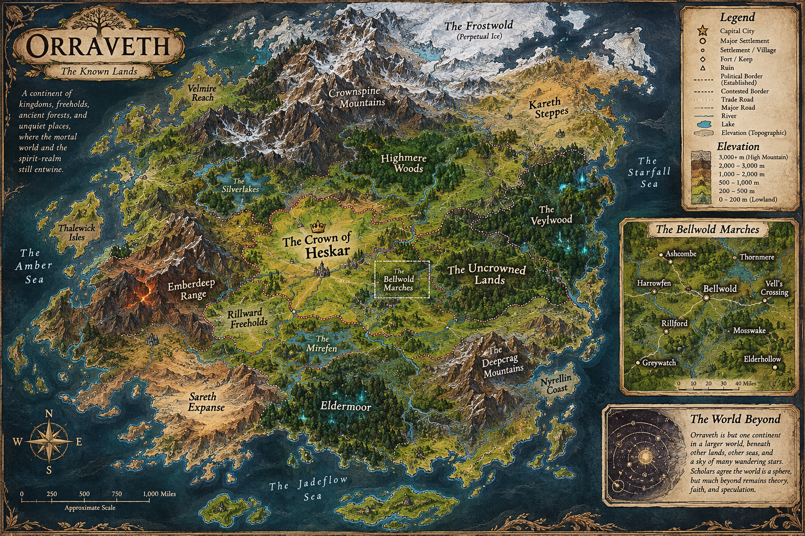
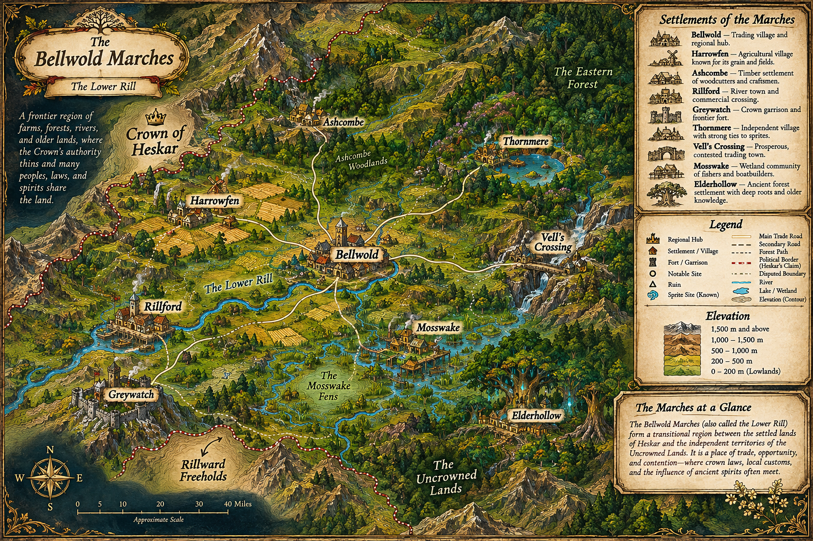

# Orraveth: Bellwold Settlement Expansion

## Player experience brief

The first session introduces Orraveth through Bellwold, a growing frontier settlement rather than a world-history lecture. Players arrive at the market, find workshops and homes along the southern lanes, meet residents with limited and distinct knowledge, and can follow a small optional investigation to the abandoned watermill. The interaction should reward observation without resolving the settlement's mysteries.

**Tone:** grounded, attentive, and quietly uncanny. Use physical details and local work as the player's entry to the setting. Keep dialogue concise, personal, and careful about the difference between a witnessed fact and an explanation.

**Session loop:** orient at the square → speak with Anwen or Tomas → choose a destination → read or inspect local material → return with an observation. Movement and interaction use the existing game client; this slice introduces no new client controls.

## Canon and source boundaries

- The canonical world name is **Orraveth**. Its Codex identifies it as the continent and setting; Bellwold is one frontier village, not the whole world.
- The Codex is the source for established facts. Its articles on Bellwold, Anwen Marr, Tomas, the Silent Bell, the unusual scale, the Kindly Roof, and the watermill informed this slice.
- The Codex establishes Bellwold's market, inn, general store, forge, healer, tower, and mill. The southern streets and additional shared buildings are a provisional expansion of the settlement layout, not a claim that every architectural detail is settled canon.
- Preserve uncertainty. The Silent Bell's history, Professor Elira Venn's disappearance, Anwen's scale, the inn's hearth, and the mill's operation are unresolved or disputed. Player-facing dialogue and readable text must not present a theory as established fact.
- Information about concealed essence extraction and its agents is not common knowledge. It is deliberately excluded from player-facing dialogue and this starter quest.
- Gold is the provisional currency name for the current Orraveth slice. Do not infer denominations, prices, or a universal exchange rate; these remain unspecified.

## Playable content in this slice

The pack (`packVersion` 1.21.0) has 130 connected locations. The market square is the starting room.

Ordinary travel and each road step cost **two stamina** in Orraveth, including
party-road travel after victory. Other worlds keep the five-stamina default;
past movement events retain their recorded cost. See
[ADR 0044](../../adr/0044-world-specific-movement-stamina-costs.md).

- **The village:** the market square, the Kindly Roof, Marr's General Goods, Old Bell Tower Road and the tower; the southern lanes, with South Common, the Green Mortar, Blackwater Forge, Well Court, Wattle Row, Soven's Wheelwright Yard, Tallow End Cottage, the Old Grain House and the Common House; and the newer rows round Hearth Alley and Lantern Court, the jail, the library and the local museum. These rooms form the `bellwold` settlement location group.
- **Roads:** five Bellwold roads with room-by-room travel and encounters (stray hounds, roadside deer, bandits): the West Road to the Western Road Verge (where the Harrowfen Road continues), the South Road over Lower Rill Bridge to the unfinished road end, the Mile Marker West Road to the Milepost Workshop (where the Rillford South Lane Road continues), the East Mill Road past the abandoned watermill, and the North Church Road.
- **Harrowfen** (Phase 1 of the region expansion): the Harrowfen Road runs on from the Western Road Verge to the East Field Gate, half a day's travel in the Codex, with four shipped moves under the historical eight-step-day layout. Ditch foxes, reedback boars and stray hounds use it. The village has the Threshing Green, the Weigh-House, a drainage cut, Tenant Row and the West Fields. Its rooms form the primary `harrowfen` settlement group, so they read as "Harrowfen: Threshing Green" and so on.
- **Rillford** (Phase 2): the Rill Towpath leaves the Reedbed Approach and follows the north bank to Rillford's North Quay, a day's travel in the Codex (eight shipped moves from South Gate under the historical layout). The Rillford South Lane Road runs from the Milepost Workshop to the south landing. Reedback boars, ditch foxes and stray hounds use them; there are no bandits. The town has the North Quay, the Ferry Stage, the Customs House, the Guild Hall, the Quayside Inn (a placeholder name), Warehouse Row, the Livestock Market, the South Landing and South Lane, in the primary `rillford` group. No boat carries passengers between the banks: the Codex records a contested ferry trade and no settled right of passage.
- **Mosswake** (Phase 3): a locally kept causeway leaves the Far Bank Track for the Landing. Boat Sheds, the Herb Platform, South Platforms and the Territory Edge form a primary, independent settlement group. Tavin Reed and an unnamed herbalist explain their own work and differing local concerns. The last planks have no exit into the recognised territory; no decision on dredging or explanation for the fish decline is authored.
- **Thornmere** (Phase 3): a locally maintained woodland footpath starts at Church Approach and ends at the Lakeshore. The Council House, Shared Bridge, healer's porch and shallow lake form a primary, independent settlement group. The bridge is scenery with no sprite-response interaction; the healer is offstage. The lake uses the existing `river` terrain purely for presentation.
- **Ashcombe** (Phase 3): the timber road starts at Westbound Track and reaches a Timber Yard, Charcoal Kilns, Kest Workshop, Cart Yard and Felled Oak Clearing in a primary Heskar settlement group. Concession boundaries remain disputed. There is no new woodcutting on the road or in town, and the oak clearing is scenery only. All three Phase 3 roads have non-primary route groups; no existing road list is extended.
- **The Lower Rill:** fourteen waterway tiles from west of Rillford to Mosswake's open water, including the Lower Rill Bridge and Rillford's Ferry Stage, in the `lower-rill` group. Three eastern reaches link to Mosswake's landing through its channel. The eastern connection is provisional layout awaiting Codex review, not a claim about the river's flow or full course. Fishing is on the bridge, at the towpath mooring posts and sparsely at Mosswake's landing. No boat, ferry or paid-passage mechanism is introduced.
- **Separate maps:** the jail cell, the library's upper room, the abandoned church's belfry and annex, and the church undercrypt maze each use their own map area or level.

Dry routes are traversable in both directions and use the supported cardinal directions. The authored graph also retains future water routes, which are blocked as described below. No two rooms share a map tile within the same map area and level.

Open-water rooms and submerged crossing states now carry an explicit
`requiresWaterTravel` requirement. Their authored connections remain on the map,
but players cannot enter or traverse them until swimming or boats are supported.
Dry bridge decks and Rillford's timber stage remain accessible. The lake and
river colours do not themselves impose this rule; see
[ADR 0043](../../adr/0043-water-travel-access-requirements.md).

Twenty-seven residents are available to meet:

- **Tavin Reed** checks a hull at Mosswake's Boat Sheds. His family knows the marsh, but he does not speak for every household or settle the dredging proposal. An unnamed **herbalist** discusses medicinal plants and families' different recognition of sprite territories without declaring a universal boundary or access right.
- **Nessa Valeen** sits at Thornmere's Council House. She asks who has been heard and how an agreement can be revisited. Her account of the medical exception does not announce a council ruling, and neither she nor the bridge promises a sprite's response.
- **Oren Kest** checks a joint at his Ashcombe workshop. He refuses timber from some stands without claiming a public map of everyone's rights. An unnamed **cartwright** explains why some workers welcome orders while leaving the concession dispute open. Oren repeats the oak reports as accounts from workers, not proof of a sprite or any other cause.

- **Reeve Maela Thorn** works at Harrowfen's Weigh-House. She speaks for the farmers on yields, landholders and the offer of cheap grain for extraction rights, and doesn't claim to know why harvests are falling. Her yield tallies record the decline without a cause.
- **Guildmistress Selda Rook** works at Rillford's Guild Hall. She supports regulated river commerce, admits she doesn't speak for every merchant, and wants cargoes written down before anyone names a cause for the overturned boats. An unnamed **customs clerk** and an **independent boatman** give the customs and anti-guild views.
- **Anwen Marr**, the practical shopkeeper, distinguishes repeatable observations from unproven causes. She sells tools and offers the Mill Ledger and Church Reliquary quests.
- **Tomas**, innkeeper of the Kindly Roof, shares road reports while making clear that reports are not guarantees.
- **Darric Holt** and **Ilya Fen**, established in the Codex as the blacksmith and healer, work at their workplaces.
- **Rell Soven**, **Enna Pell**, **Seli Tor** and **Aven Rusk** are provisional residents associated with wheel repair, public records, weaving and grain storage. Their knowledge stays close to their work.
- **Sella Nettlemere**, **Tovin Ashdown**, **Renna Kell**, **Pella Wren**, **Sergeant Nera Vail**, **Mira Dell** and **Nessa Rill** live and work in the newer rows, jail, library and Milepost Workshop. They are not yet in the Codex.
- **Linnet Reed** walks among Bellwold's public streets without a fixed itinerary; **Taren Voss** and **Orin Vale** follow fixed routes.

Two optional, character-scoped quests are available. **The Mill Ledger** asks the player to read the mill's ledger and report its observations to Anwen; it has no reward and does not establish why the wheel moved. **The Church Reliquary** sends the player through the church undercrypt for a reliquary sword, with a 20-gold reward.

Daily jobs on the South Common board, woodcutting, fishing, crafting at the Milepost Workshop and equipment all use existing engine capabilities.

## Content authoring guardrails

- Keep NPCs' knowledge local and attributable. Do not make every resident an expert on every mystery.
- Treat the new residents, southern buildings, and their exact arrangement as provisional until separately approved; do not extend their biographies or relationships beyond the documented facts.
- Autonomous movement uses the existing shared-world NPC capability: Linnet may choose among authored public destinations, while Taren follows his ordered route. Neither behavior makes the NPC a combatant.
- Build content from existing engine capabilities. A new world mechanic needs its own engine contract first.
- Keep stable IDs stable when names or prose change. A location ID must never be repurposed for a different place.
- Keep concealed canon (the watermill's extraction apparatus and Severin Vale's agents) out of every player-facing string. Room text also appears in destination previews before arrival. The integration test scans the pack for these terms.
- Grow the region by following [bellwold-region-expansion.md](bellwold-region-expansion.md). New roads start from an existing road's endpoint rather than extending that road, and NPCs the Codex doesn't name are unnamed roles.
- Treat substantial additions to unresolved mysteries as proposals for Codex review before they become canonical.

## World identity and ownership

This is the separate Orraveth pack and world instance, not an extension of the MUDD demo world. Character state remains scoped to its selected world instance under [ADR 0022](../../adr/0022-world-selection-and-character-world-ownership.md). The one-active-character-per-world-session rule remains unchanged.

## Overland design for new Orraveth routes

Sketch the land before tracing roads or placing settlements. Identify the traveler: a loaded wagon needs firm ground, gentle grades and turning space; a walker can use a steeper, narrower path. Follow ridges, valleys and practical crossings where they make travel easier. Bend around wet hollows, steep banks and exposed rock. Straight stretches are appropriate on level, firm ground. Give important turns an observable explanation in room prose, such as a root-bound bank rising beside the track.

After selecting the route, budget roughly **48 room-to-room moves per fictional travel day**, from the settlement departure point to the destination arrival point. Half, one, one and a half, and two days suggest 24, 48, 72 and 96 moves. A 48-move unbranched route includes 49 rooms counting its start. This Orraveth authoring convention applies prospectively. Existing routes retain their documented shipped lengths until deliberately redesigned. Count an intended itinerary and note any shorter alternative, terrain exception or wagon detour. Reconsider spacing or route choice before adding turns solely to meet a count. Settlement interiors need their own scale.

### Supplied geographic references

The following original images were supplied by the user on 2026-11-04 as design references. Read their details with the reconciliation key below.



Orraveth — The Known Lands. [Full-resolution original](assets/orraveth-known-lands.png).



The Bellwold Marches — The Lower Rill. [Full-resolution original](assets/bellwold-marches-topography.png).

### Regional terrain sketch and reconciliation key

North is up. Positions and connections below express relationships; the line lengths are schematic.

```text
                  N
                  ^
     Ashcombe     |       Thornmere
          Bellwold        Vell's Crossing
              |
        Lower Rill bridge
              |
              A----B
                   |
                   C----D Mosswake landing
                        |
                        E boat sheds
```

| Mark or feature | Status and source | Authoring consequence |
| --- | --- | --- |
| Bellwold, bridge, Mosswake | Established in the [Bellwold](../../../apps/web/src/codex/content/regions/bellwold.md) and [Mosswake](../../../apps/web/src/codex/content/regions/mosswake.md) articles; Mosswake is southeast of Bellwold | Anchor the approach to an existing crossing and wetland arrival |
| Other settlement positions | Approximate relationships in [Bellwold Marches](../../../apps/web/src/codex/content/regions/bellwold-marches.md) | Preserve regional direction when proposing exact positions |
| A to B, firm strip | Proposed terrain detail | A cart can follow a direct stretch on dry ground |
| B to C, wet hollow beside a raised margin | Proposed terrain detail | Turn along the margin rather than continuing onto soft ground |
| C to D, navigable channel and firm landing patch | Proposed alignment; wet ground and platforms are established at Mosswake | Place an unloading point where land access meets boat access |
| D to E, walkway to boat sheds | Proposed alignment; boatbuilding is established | Keep workshops near unloading, with a raised path across wet ground |

The regional image's sharp political border and the continental image's bounded Uncrowned Lands need interpretation against the Codex's disputed and locally understood claims. The regional map itself distinguishes Heskar's claim from a disputed boundary. Neither illustration settles a complete border. Rillford's illustrated crossing does not authorize a ferry service or land passage between its banks. Follow the existing authored access restrictions.

Elevation bands, contour placement, exact mountain positions and mileage shown in the illustrations are proposed visual detail unless independently supported by a cited article. The drawings also add broad continental detail beyond this regional guide. Confirm names and relationships against the relevant Codex entry before using them as established facts. Their scale bars are approximate illustration scales; there is no fixed conversion from miles or drawing pixels to the 48-move budget. The Lower Rill's downstream direction remains unresolved in the [expansion plan](bellwold-region-expansion.md). River branches and waterfalls in the pictures require review before establishing flow or gradient.

### Worked example — Mosswake approach and settlement

A future wagon approach could follow A–B directly along a firm strip, bend at B beside a reed-filled hollow, then continue through C to the landing at D. A traveler sees wheel ruts ending at the hollow and stakes marking the firmer edge. The bend follows the ground. The landing uses a patch where a boat can unload; boat sheds at E share access to the channel, and a raised walkway connects them across seasonally wet ground. Each precise alignment in this example is provisional.

Today's South Gate-to-Mosswake journey takes nine moves. A future design using the one-day Codex estimate would budget about 48 moves between those endpoints, distributing them across meaningful ground and landmarks. A half-day Bellwold departure-to-Harrowfen arrival would suggest about 24. These are design budgets to evaluate after terrain and settlement placement. Before releasing an expanded route, playtest travel friction, rest opportunities and encounter frequency: Orraveth charges two stamina per move and roads roll encounters per step.
