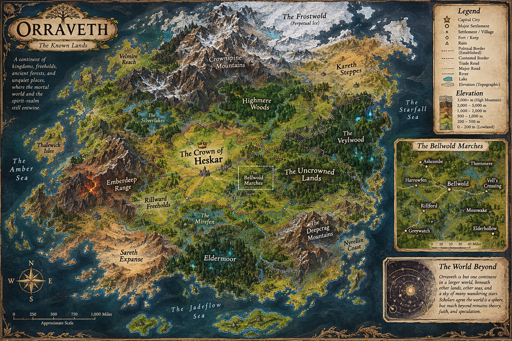
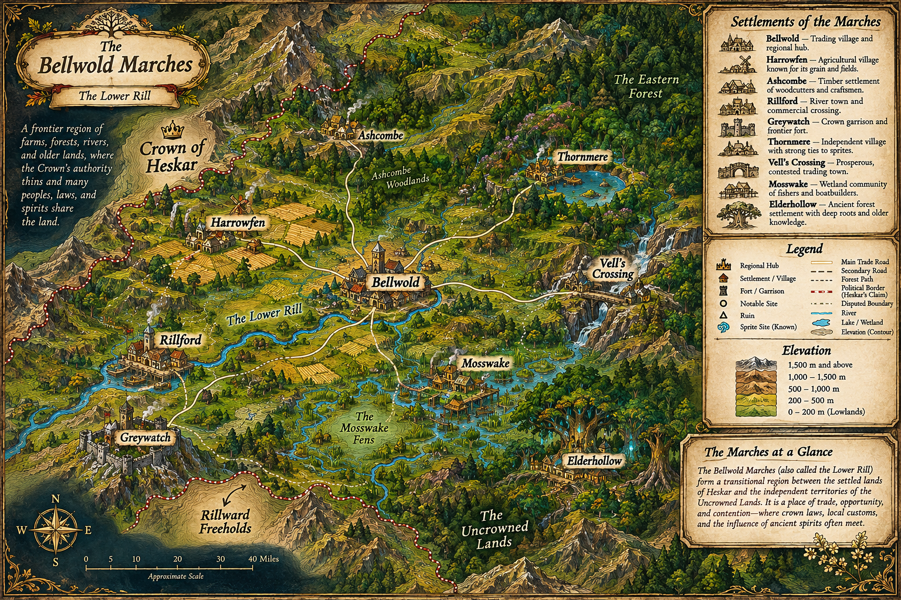

# Define Orraveth overland design

## Why

The Bellwold expansion plan placed settlements using about eight road moves per fictional travel day. For future Orraveth designs, authors need a common picture of the land and a more spacious travel scale so that roads, crossings, and settlements make geographic sense together.

## What Changes

- Establish a prospective Orraveth convention of roughly 48 overland room-to-room moves per fictional travel day. Count from departure to arrival along the intended route.
- Add terrain-first guidance to the world bible and link it from the Orraveth pack authoring guide. Explain when travelers would bend around an obstacle and when a direct road is plausible.
- Provide a regional terrain sketch with a key that distinguishes established features, proposed details, and unresolved questions.
- Include the two supplied maps in the world bible, with captions, text descriptions and links to the full-resolution originals.
- Use the Mosswake approach and settlement as one worked example. Mark the old eight-step decision as historical wherever it could still direct future authors.

## Capabilities

### New Capabilities

None. This change produces author-facing documentation.

### Modified Capabilities

None. The guidance applies when designing a new or deliberately revised Orraveth route.

## Impact

The deliverables belong in Orraveth's world-design documents and pack README. A playable-map rebuild, changes to Codex lore or the demo world, and runtime travel-time configuration are outside scope.

## Supplied map references

These images were supplied by the user on 2026-11-04 for inclusion in the world bible. The originals are retained with this proposal. Use them to discuss regional terrain and route design, with a companion key recording how their labels, borders, elevations and scale relate to established lore and unresolved geography.

### Orraveth — The Known Lands

Continental context for the Bellwold region. [Full-resolution map](assets/orraveth-known-lands.png).

### The Bellwold Marches — The Lower Rill

Regional reference for terrain-driven roads and settlement placement. [Full-resolution map](assets/bellwold-marches-topography.png).
